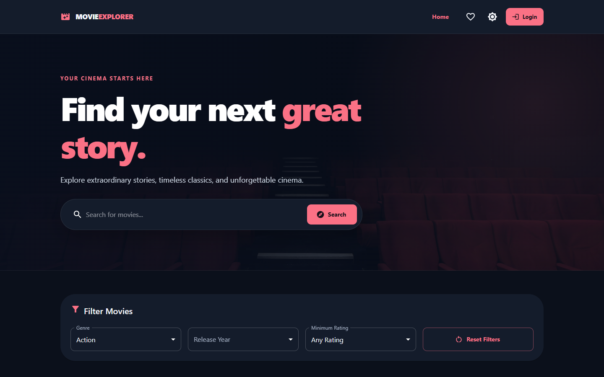
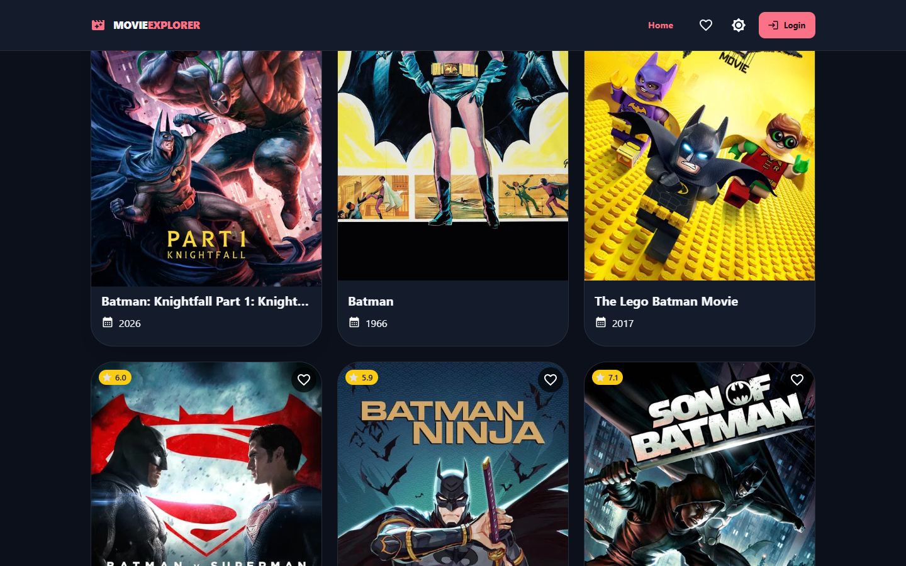
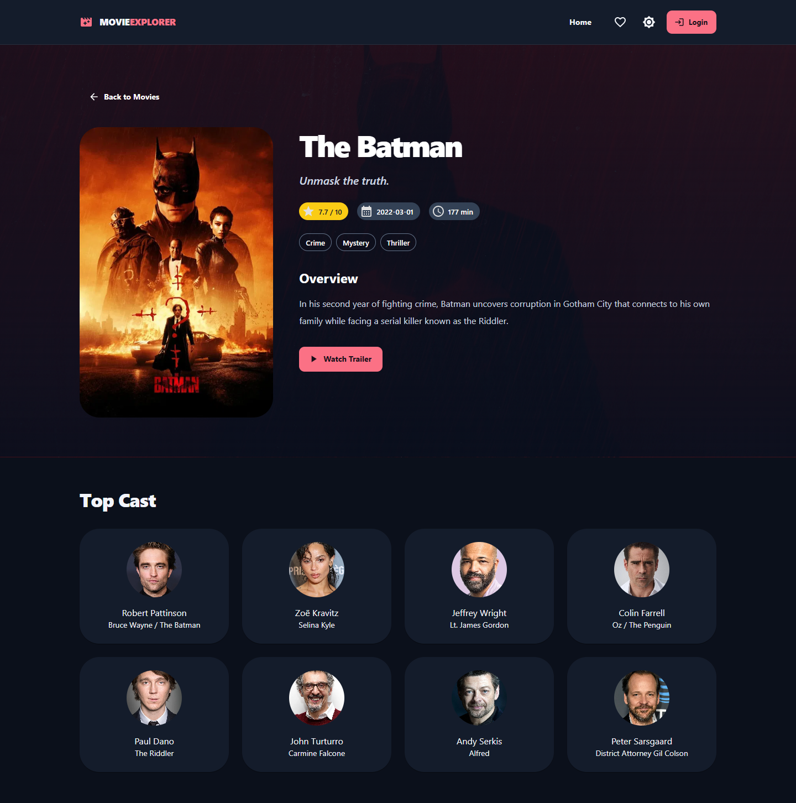
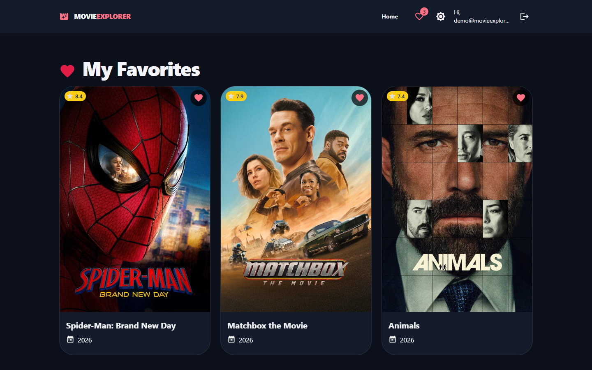
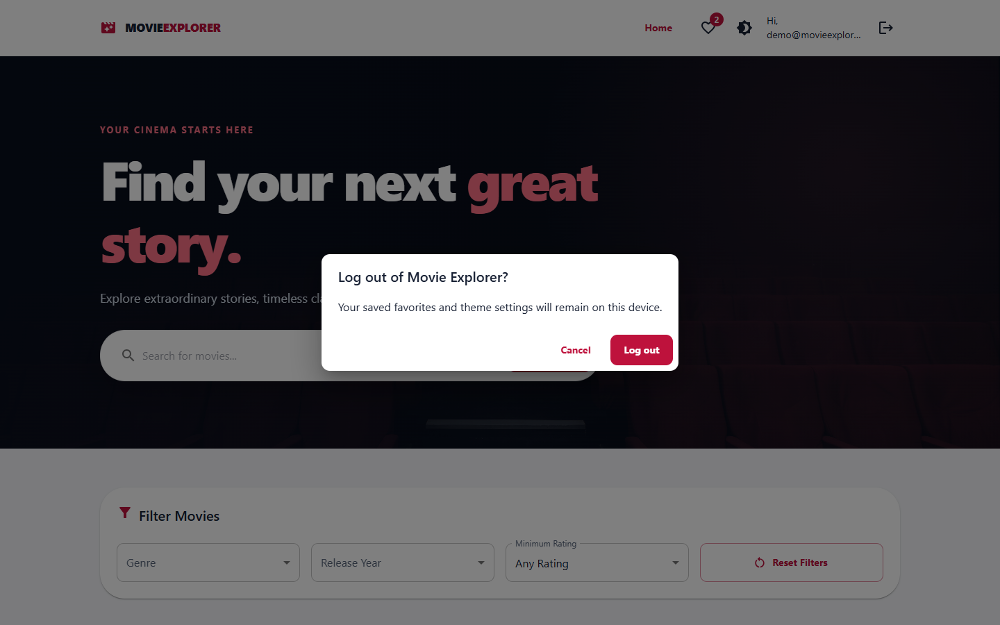
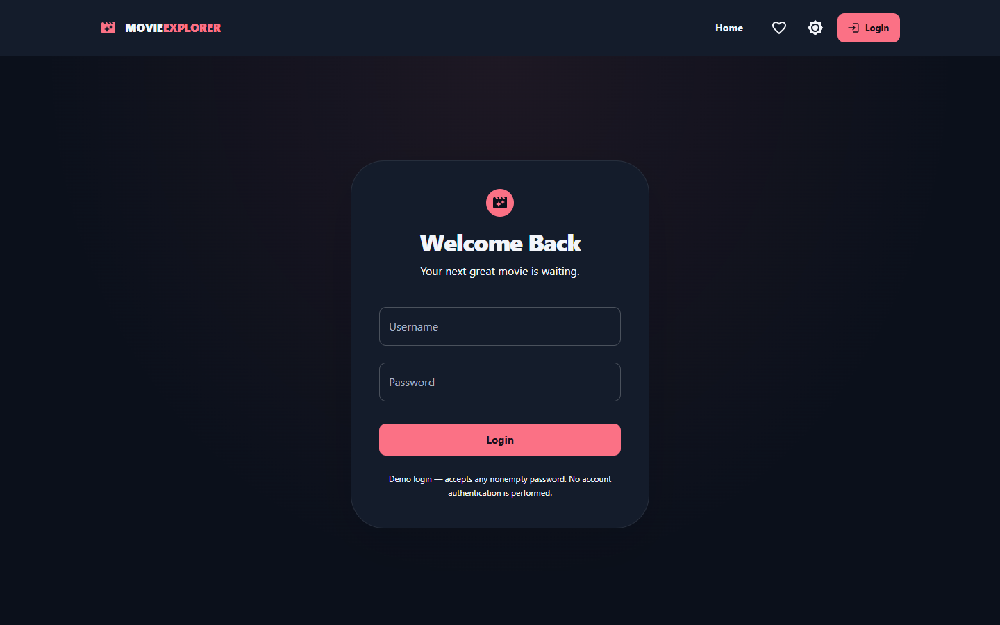
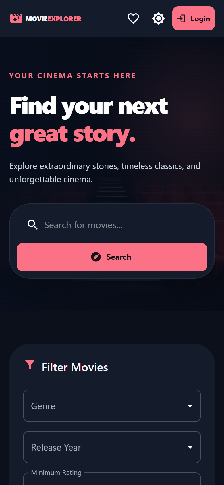
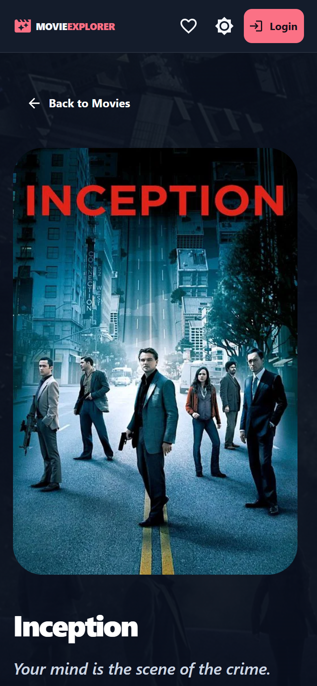

# Movie Explorer

A responsive movie discovery application built with React, Material UI, React Router, Axios, and the TMDb API.

## Features

- Trending movies and title search
- Movie details with overview, genres, rating, runtime, cast, and trailers
- Login-gated favorites persisted in browser storage
- Demo login/logout with logout confirmation
- Light and dark themes with persistence
- Genre, release-year, and minimum-rating filters
- Load More pagination and optional infinite scrolling
- Loading, empty, retry, and API error states
- Responsive desktop, tablet, and mobile layouts

## Live links

- Live demo: https://movie-explorer-beta-beige.vercel.app
- GitLab: [Movie Explorer on GitLab](https://gitlab.com/Laksopan23/movie-explorer)
- GitHub: [Movie Explorer on GitHub](https://github.com/Laksopan23/movie-explorer)

## Setup

Requirements: Node.js and npm.

```powershell
npm install
Copy-Item .env.example .env
npm start
```

Open `http://localhost:3000`.

Set at least one TMDb credential in `.env`:

```env
REACT_APP_TMDB_API_KEY=YOUR_TMDB_V3_API_KEY
# Or use the read access token:
# REACT_APP_TMDB_READ_ACCESS_TOKEN=YOUR_TMDB_READ_ACCESS_TOKEN
```

Never commit `.env`. Create React App embeds `REACT_APP_*` values in the browser bundle, so use a backend/serverless proxy when the credential must remain private.

## Commands

```powershell
npm start
npm test
npm run build
```

## API integration

Requests are centralized in `src/services/tmdbApi.js` and cover:

- `/trending/movie/week`
- `/search/movie`
- `/discover/movie`
- `/genre/movie/list`
- `/movie/{movie_id}` with credits and videos

Pagination uses TMDb's `page` parameter. Infinite scrolling uses `IntersectionObserver`.

## Architecture

- `src/components`: reusable UI pieces and filters
- `src/pages`: Home, Movie Details, Favorites, and Login screens
- `src/services`: TMDb API client
- `src/context`: favorites, theme, and demo-user state
- `src/theme`: Material UI theme configuration

The login is intentionally a demonstration flow; it does not authenticate against a server. Favorites, theme, and the last search are stored locally in the browser.

## Deployment

`vercel.json` contains the SPA rewrite required for React Router refreshes. For Vercel, use:

- Build command: `npm run build`
- Output directory: `build`
- Environment variable: `REACT_APP_TMDB_API_KEY` or `REACT_APP_TMDB_READ_ACCESS_TOKEN`

Add the generated deployment URL to the Live links section above after deployment.

## Screenshots

### Home and discovery

| Trending movies | Batman search |
|---|---|
|  |  |

| Genre filtering | Pagination |
|---|---|
|  |  |

### Movie details and favorites

| Movie details | Favorites with items | Logout confirmation |
|---|---|---|
|  |  |  |

### Authentication and responsive layouts

| Login page | Mobile home | Mobile movie details |
|---|---|---|
|  |  |  |

## Testing checklist

Before submission, verify homepage loading, search, details, direct-route refresh, login/logout, guest favorite protection, favorites persistence, theme persistence, filters, pagination, infinite scrolling, mobile layout, and browser console errors.

## TMDb attribution

This product uses the TMDb API but is not endorsed or certified by TMDb. Movie data and imagery are provided by [The Movie Database](https://www.themoviedb.org/).

## Assessment note

This project was created for a developer selection assessment. The confidential assessment document and local credentials must not be committed.


